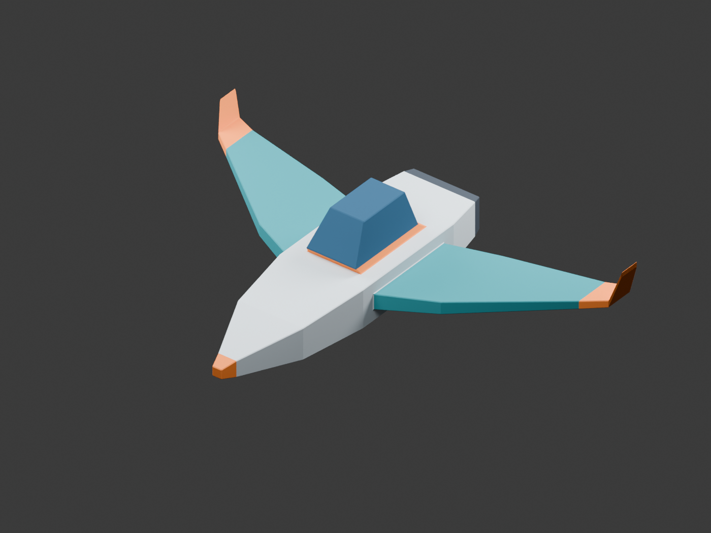

# Laboratorio 3: Modelo 3D

Miguel Rosas - 241274 | Graficas por computadora

Nave espacial simple construida en Blender a partir de un solo cubo.

## Archivos del proyecto

| Archivo | Uso |
| --- | --- |
| [modelo/nave_aster.obj](modelo/nave_aster.obj) | Modelo 3D triangulado para cargar en el renderer. |
| [modelo/nave_aster.mtl](modelo/nave_aster.mtl) | Seis colores base; conservar junto al OBJ. |
| [modelo/nave_aster.blend](modelo/nave_aster.blend) | Editable de Blender con un solo objeto de malla. |
| [capturas/nave_perspectiva.png](capturas/nave_perspectiva.png) | Imagen de la nave desde delante. |
| [capturas/nave_posterior.png](capturas/nave_posterior.png) | Imagen posterior que muestra la tobera. |
| [capturas/nave_giro.gif](capturas/nave_giro.gif) | Animacion de un giro completo de la nave. |

## Vista previa



Vista animada:


## Construccion

Nave Aster: fuselaje perla, alas color petroleo, cabina azul y detalles naranja.
Se crea un unico cubo y se escalan sus vertices para formar el cuerpo central.
De sus caras se extruyen el morro, las dos alas barridas, sus puntas elevadas,
la cabina y la popa. Los insets se construyen extruyendo una cara sin desplazarla
y escalando la cara nueva; la tobera se extruye hacia dentro y queda cerrada.
Todas las partes pertenecen a la misma superficie conectada.

Solo se usan operaciones equivalentes a Move, Scale, Extrude e Inset, mas
modificadores Bevel y Triangulate. El script automatiza esas operaciones dentro
de Blender; no importa modelos ni agrega primitivas adicionales.
El editable conserva ambos modificadores y la exportacion los aplica.
Las luces y camaras de las imagenes son temporales: se crean despues de guardar
el editable y exportar el OBJ, por lo que no aparecen en los archivos 3D.
Los materiales no tienen texturas ni nodos; usan colores base opacos.

## Abrir el modelo

1. Abrir `modelo/nave_aster.blend` en Blender 4.5 o posterior. Usar el modo de
   color **Material** en la vista solida para ver los colores.
2. Para importar el OBJ: **File > Import > Wavefront (.obj)**. Mantener el MTL
   en la misma carpeta. La exportacion usa **-Z Forward / Y Up**; dentro de
   Blender el morro apunta a -Y y el eje vertical es +Z.

## Ejecutar y reproducir

Desde la carpeta del repositorio, con Blender 4.5 en el PATH:

```powershell
blender --background --python scripts/crear_nave.py
python scripts/verificar_obj.py
blender --background --python scripts/verificar_blender.py
```

Si Blender no esta en el PATH, sustituir `blender` por la ruta completa a su
ejecutable. El generador vuelve a escribir el editable, el OBJ, el MTL y las dos
imagenes. La verificacion con Python solo requiere la biblioteca estandar.

Para regenerar tambien el GIF (24 fotogramas, 720 x 540, giro de 2.4 segundos):

```powershell
blender --background --python scripts/crear_nave.py -- --giro
python -m pip install Pillow
python scripts/crear_gif.py
```

## Validacion

El OBJ contiene **224 vertices y 444 triangulos**, en un solo objeto conectado.
Se comprobaron indices, area no nula de cada triangulo, normales consistentes,
volumen positivo, dos caras por arista y ausencia de vertices sueltos.
La superficie esta cerrada y su caracteristica de Euler es 2.
Tambien se verifica la reapertura del editable y la reimportacion del OBJ en
Blender, conservando el numero de vertices, triangulos y seis materiales.
Las dos imagenes se revisaron visualmente.
